<picture>
  <source media="(prefers-color-scheme: dark)" srcset="./assets/header-dark.svg">
  
</picture>

  
  
  
  
   
  
  
  
  

## 👋 About me

I'm an AI Engineer with 5+ years of commercial experience in LLM products. I build LLM agents and multi-agent systems that serve thousands of users, and RAG over terabytes of data. I own the full cycle, from requirements and dataset curation to fine-tuning, systematic evals and production rollout with observability and CI/CD, and a change ships only when the evals show that it works.

📍 Belgrade, Serbia, GMT+1, remote&nbsp;&nbsp;·&nbsp;&nbsp;🎓 M.Sc. in AI at ITMO, B.Sc. in Applied Mathematics and Computer Science at SPbU&nbsp;&nbsp;·&nbsp;&nbsp;🗣️ English, Russian

## ⚙️ What I do

- 🤖 **Agents and multi-agent systems.** I design agent graphs with LangGraph and the OpenAI Agents SDK, connect tools over MCP and run them in production for thousands of users.
- 📚 **RAG at scale.** My retrieval pipelines search millions of documents and terabytes of data with hybrid search and reranking on Qdrant and pgvector.
- 📏 **Evals before every release.** Golden datasets of thousands of cases come from real user questions. LLM-as-a-judge, ragas and DeepEval score them, and a release ships only when the scores hold.
- 🔭 **Observability.** Langfuse and OpenTelemetry trace every agent step, so a failure in production leads straight to its cause.
- 🧪 **Fine-tuning and serving.** When an API model is too slow or too costly, I fine-tune an open-weight LLM with SFT, LoRA or DPO and serve it with vLLM.
- 📊 **Experiments.** Product changes go through A/B tests with statistical hypothesis testing before they reach every user.
- 🛡️ **Security.** Before launch, agents get guardrails, tests against prompt injection and a round of red teaming.

## 🧰 Tech stack

  <picture>
    <source media="(prefers-color-scheme: dark)" srcset="https://skillicons.dev/icons?i=py%2Cts%2Cpytorch%2Csklearn%2Cfastapi%2Cpostgres%2Credis%2Celasticsearch%2Ckafka%2Cdocker%2Ckubernetes%2Caws%2Cgcp%2Cterraform%2Cgithubactions%2Cgrafana%2Clinux%2Creact&perline=9&theme=dark">
    
  </picture>

| Area | Stack |
|---|---|
| **LLM agents** | LangGraph, OpenAI Agents SDK, Claude Agent SDK, Google ADK, MCP, A2A, Multi-Agent Systems, Agentic Workflows, Tool Calling, Structured Outputs, Context Engineering, Harness Engineering, Prompt Engineering, DSPy, LangChain, LlamaIndex, CrewAI, AutoGen |
| **LLM APIs** | OpenAI API, Anthropic API, AWS Bedrock, Vertex AI, OpenRouter, Hugging Face |
| **RAG and search** | Qdrant, pgvector, Pinecone, Weaviate, FAISS, Chroma, Elasticsearch, Embeddings, Hybrid Search, Reranking, Semantic Search, GraphRAG, Knowledge Graphs, Neo4j |
| **Evals and observability** | Eval-Driven Development, Golden Datasets, LLM-as-a-Judge, ragas, DeepEval, Promptfoo, LangSmith, Braintrust, Human Annotation, Label Studio, Langfuse, OpenTelemetry, Grafana |
| **AI safety** | Guardrails, Prompt Injection Defense, Red Teaming, Responsible AI |
| **Fine-tuning** | PyTorch, Transformers, TRL, PEFT, SFT, LoRA, DPO, RLHF, Reinforcement Learning, Distillation, Synthetic Data, Axolotl, Small Language Models, Multimodal LLMs |
| **Inference** | vLLM, SGLang, Quantization, bitsandbytes, TensorRT, Triton, ONNX, CUDA |
| **ML and experiments** | A/B Testing, Statistical Hypothesis Testing, scikit-learn, XGBoost, CatBoost, pandas, NumPy, Optuna, Time Series, Recommender Systems, Computer Vision, OpenCV |
| **MLOps** | MLflow, ClearML, Weights & Biases, DVC, Hydra, Apache Airflow |
| **Software engineering** | Python, SQL, TypeScript, FastAPI, Pydantic, REST APIs, PostgreSQL, Redis, Kafka, React, Next.js, System Design, Microservices |
| **Cloud and DevOps** | Docker, Kubernetes, AWS, GCP, Terraform, GitHub Actions, CI/CD, Linux, uv, Ruff, pytest |
| **AI coding** | Claude Code, Codex, Cursor, GitHub Copilot |

## 🛠 Open-source projects

| Project | What it does |
|---|---|
| **BotLLM** LangGraph · RAG · Docker | A RAG agent in Telegram that answers questions about a company's products and services from its document base. Retrieval is one tool among several, and the dialog is an explicit LangGraph graph.   |
| **YandexGPT Python SDK** asyncio · PyPI | An async Python SDK for the YandexGPT API with API-key and IAM authentication, published on PyPI with docs on Read the Docs.    |
| **AI Secretary** WhisperX · FastAPI · Telegram | A Telegram assistant that transcribes and summarizes meeting recordings and answers questions about them. WhisperX runs as a separate FastAPI service, and a self-hosted Telegram Bot API server lifts the file size limit.   |
| **Personal CRM** FastAPI · React · TypeScript | A single-user CRM with a Kanban board of contacts and a graph of relationships, on PostgreSQL and MinIO.  |

More LLM apps from 2024

 

- **CoverLetterEnhancer** drafts a cover letter from a CV and a job posting with FastAPI and YandexGPT. [Front end](https://github.com/allseeteam/cover-letter-enchancer-frontend) · [Back end](https://github.com/allseeteam/cover-letter-enchancer-backend) · [Habr](https://habr.com/ru/articles/796107/)
- **AutoLove** is a Telegram bot that sends smart daily updates to your partner. [Code](https://github.com/allseeteam/auto-chat) · [Habr](https://habr.com/ru/articles/795597/)
- **AI Santa** generates holiday video cards with YandexART and YandexGPT. [Habr](https://habr.com/ru/articles/870844/)
- **Skill Extractor** finds skills in résumés with YandexGPT and no labeled data. [Habr](https://habr.com/ru/articles/823035/)

## 🏆 Hackathons

I compete in AI hackathons as a hobby: 9 prize places since 2023, and 6 of them are first places.

All results

 

| Place | Hackathon | Case | Links |
|---|---|---|---|
| 🥉 3rd | **"Working Title" Hackathon 2025** HeadHunter · Oct 2025 | A generator that shows what working at a company feels like | [Code](https://github.com/bukhanka/hruhruhru) · [Certificate](https://drive.google.com/file/d/1P3zbw5J3otgPf4enr0L1IstLkWI2LJkw/view?usp=sharing) |
| 🥉 3rd | **Digital Transformation Leaders 2025** Moscow Government · Oct 2025 | An LLM agent that builds data pipelines in place of a data engineer | [Code](https://github.com/PE51K/lct-hack-2025) · [Certificate](https://drive.google.com/file/d/1pmEuRKfoVlcCeuAwX-DAJsn0ru5dAn3D/view?usp=sharing) |
| 🥇 1st | **AI Product Hack 2025** Yandex · Sep 2025 | An AI career coach companion | [Code](https://github.com/denisalpino/AITHachathon) · [Certificate](https://drive.google.com/file/d/19cAOVOapiwOCh_LU5l_WOXew-tOJexnI/view?usp=sharing) |
| 🥈 2nd | **LLM Coding Challenge 2025** AlfaStrakhovanie · Feb 2025 | A report on developers' code quality | [Code](https://github.com/AGI-in-2024/llm_coding_challenge) · [Certificate](https://drive.google.com/file/d/12yMFQXzp_wukbWQN1I59NB6knd0BkQVs/view?usp=sharing) |
| 🥇 1st | **Digital Breakthrough 2024, National Final** Gazprom-Media · Sep 2024 | Automatic tagging of video content for editors | [Code](https://github.com/AGI-in-2024/AI-Video-Analysis) · [Certificate](https://drive.google.com/file/d/1lBvni3fFfGRgwPtrkvDX31CRQNJIVUuD/view?usp=sharing) |
| 🥇 1st | **AI Product Hack 2024** Citilink · Feb 2024 | Generation of product cards for an online store | [Code](https://github.com/PE51K/ai-product-hack-2024) · [Certificate](https://drive.google.com/file/d/1F20WtVBBl6RCzszugy_UtO-bhDV0XY1k/view?usp=sharing) |
| 🥇 1st in case 2nd overall | **AI Generative Product Hack 2023** Binnopharm Group · Sep 2023 | LLM analysis of advertising campaigns for marketers | [Certificate](https://drive.google.com/file/d/1Y6OgeLA4RfYE2LQRlDv9Jttaa8zZj4QV/view?usp=sharing) |
| 🥇 1st in case 6th overall | **FinnoDays 2023** Center-Invest Bank · Sep 2023 | Personalized cashback in a smart loyalty system | [Code](https://github.com/AlexStr94/finodays) · [Certificate](https://drive.google.com/file/d/1JpEtCO2Jpou1cQzICTJ2cX31l5Irrdzc/view?usp=sharing) |
| 🥇 1st | **Digital Breakthrough 2023, South Federal District** Central Bank of Russia · Feb 2023 | Prediction of macro-financial model parameters for economists | [Certificate](https://drive.google.com/file/d/1CkjEtedA5DT1NeSmxuGtiAhXybYbVfaL/view?usp=sharing) |

I also open-sourced my code from [Ozon E-CUP 2025](https://github.com/PE51K/ozon-e-cup-hack-2025), where we predicted the next item a customer buys, [Archipelago 2025](https://github.com/PE51K/archipelago-hack-2025), where we detected people in drone images, and [AI Trade Hack 2025](https://github.com/PE51K/ai-trade-hack-2025), where we predicted asset prices from news.

## 🔬 Research and talks

- 📄 **[Uncertainty Decomposition for Clarification Seeking in LLM Agents](https://arxiv.org/abs/2606.19559)**, arXiv 2026, sole author. The method tells an agent when to ask the user instead of guessing, and the paper tests it on five benchmark setups with five LLMs. 
  
  
- 🧪 In progress at ITMO University: environment synthesis and reinforcement learning for interactive and proactive LLM agents, and VLA models for robotics.
- 🎤 Talk and workshop on AI in software development at the AI Business SPB meetup in June 2026. [Video in Russian](https://www.youtube.com/watch?v=JXS0KCSXcRk) · [Workshop demo](https://pe51k.github.io/ai-in-dev-meetup/)
- 🎓 For my bachelor's thesis, I fine-tuned Moshi, an open speech-to-speech LLM, to help Russian speakers practice spoken Chinese. [Code](https://github.com/PE51K/ru-zh-moshi)

## 🤝 Let's talk

I'm open to new projects, collaboration and networking, and I give talks and workshops on AI in software development. Message me on [WhatsApp](https://wa.me/19406026989) or [Telegram](https://t.me/gregory1m), or write to [g.matsnev.ai@gmail.com](mailto:g.matsnev.ai@gmail.com).
